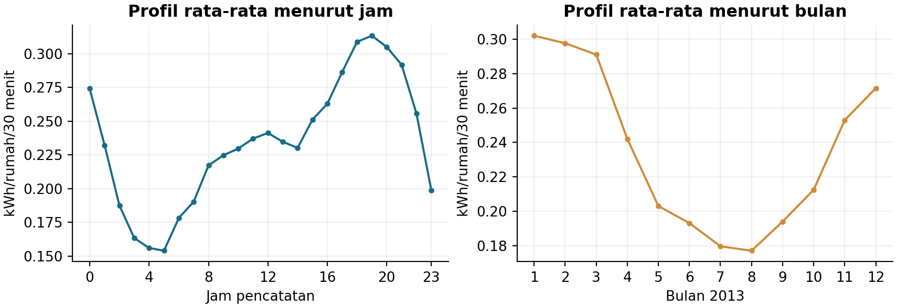
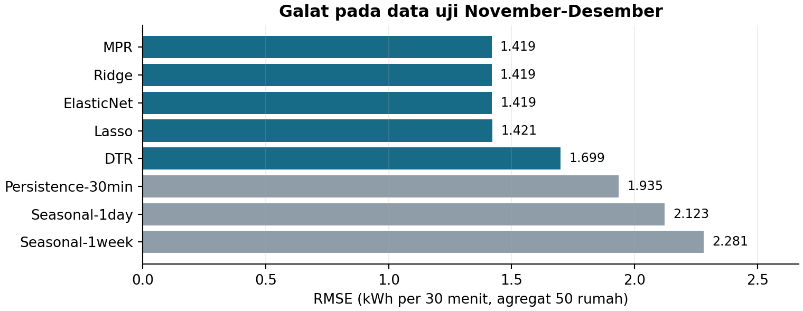
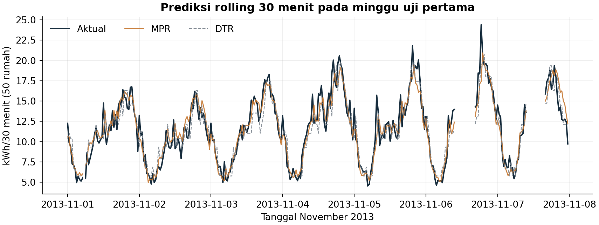

LAPORAN TUGAS
EKSPLORASI MANDIRI MAHADATA

REPLIKASI PARSIAL PREDIKSI BEBAN LISTRIK
LOW CARBON LONDON MENGGUNAKAN
APACHE SPARK SQL DAN MLLIB

Mengacu pada Ali El-Sayed Ali et al. (2024)
DOI: 10.1186/s40537-024-00909-6

Disusun oleh

RAY REGAN SITEPU
NIM 123140047
Kelas R

PROGRAM STUDI TEKNIK INFORMATIKA
FAKULTAS TEKNOLOGI INDUSTRI
INSTITUT TEKNOLOGI SUMATERA
2026

---

# I. RINGKASAN JURNAL

## 1.1 Identitas dan Permasalahan Penelitian

Artikel utama ialah “Big data resolving using Apache Spark for load forecasting and demand response in smart grid: A case study of Low Carbon London Project” oleh Hussien Ali El-Sayed Ali, M. H. Alham, dan Doaa Khalil Ibrahim. Artikel diterbitkan pada Journal of Big Data, volume 11, artikel 59, tahun 2024, dengan DOI 10.1186/s40537-024-00909-6 (Ali El-Sayed Ali et al., 2024).

Permasalahan yang diangkat ialah pengolahan rekaman meter berskala besar untuk prediksi beban dan evaluasi respons permintaan. Jurnal diterbitkan Springer Nature dan terindeks Scopus serta SCIE menurut halaman penerbit. Daftar SCImago kategori Information Systems yang memuat data 2024 menampilkan Q1 dengan SJR 1,979. Received tercatat 26 Agustus 2023, accepted 7 April 2024, dan tanggal terbit 28 April 2024 (Springer Nature, n.d.; SCImago, n.d.).

## 1.2 Dataset, Lingkungan, dan Metode

Penelitian menggunakan rekaman LCL dari 5.567 rumah, dengan cuaca, ACORN, dan kalender. Spark SQL mendukung analisis deskriptif, sedangkan MLlib menjalankan regresi polinomial dan decision tree. Dataproc memakai satu master dan tiga worker; masing-masing memiliki 2 vCPU dan RAM 7,5 GB (Ali El-Sayed Ali et al., 2024).

Sebagai dasar replikasi, laporan ini memisahkan pengolahan rekaman meter, pembentukan target agregat, serta evaluasi model. Data mentah yang tersedia berisi ID rumah, kategori tarif, waktu, dan energi kWh per setengah jam. Cuaca serta pemetaan ACORN tidak tersedia pada folder kerja. Karena itu, fitur tambahan dirancang dari kalender dan energi masa lalu, dengan penjelasan eksplisit mengenai batas perbandingan.

## 1.3 Hasil Utama Artikel dan Alasan Pemilihan

Ridge pada Tabel 6 artikel mencapai R2 0,965 untuk seluruh rumah dan 0,943 untuk Block #0. Angka tersebut adalah hasil penelitian asli. Artikel menekankan manfaat agregasi serta keterbatasan untuk kelompok rumah kecil (Ali El-Sayed Ali et al., 2024).

Artikel dipilih karena datasetnya sudah tersedia dan bagian inti dapat dijalankan dengan Spark lokal. Sasaran eksperimen adalah memeriksa apakah prediksi 30 menit berikutnya pada 50 rumah lebih baik daripada baseline energi sebelumnya; membandingkan regularisasi dan kedalaman pohon; serta menjelaskan perbedaan hasil dengan artikel tanpa merekayasa angka.

---

# II. TAHAPAN IMPLEMENTASI ATAU EKSPERIMEN

## 2.1 Bentuk Replikasi dan Sasaran

Pekerjaan tergolong replikasi parsial dengan perluasan fitur lag. Spark SQL dan MLlib benar-benar dijalankan pada data LCL. Cakupan tidak meliputi klaster Dataproc, pemetaan blok geografis, pengujian tarif ToU, maupun simulasi energi terbarukan. Seluruh data lokal berjumlah 168 CSV, 167.932.474 baris, atau 8,54 GB; input eksperimen adalah tiga CSV bernomor 0, 1, dan 2 dengan 3.000.000 rekaman dan 82 ID rumah.

## 2.2 Lingkungan Perangkat Lunak

Lingkungan dan konfigurasi aktual berasal dari environment.json. Versi pustaka utama dicatat dalam requirements.txt, sedangkan seluruh dependensi dipin pada requirements-lock.txt. Java 17/21 didukung Spark 4.0.1 (Apache Software Foundation, 2025a).

Tabel 1. Lingkungan dan parameter eksperimen (sumber: environment.json).

| Komponen | Konfigurasi tercatat |
| --- | --- |
| Platform | Windows-11-10.0.26200-SP0; Spark local[2] |
| Python / PySpark | 3.13.2 / 4.0.1 |
| Java | 21.0.12.1 |
| NumPy / pandas | 2.3.3 / 2.3.3 |
| Heap / partisi shuffle | 4 GB / 8 |
| Seed / parsing waktu | 42 / UTC sebagai aturan parsing |

## 2.3 Rancangan Variasi Parameter

Sebelas kandidat parameter diuji pada validasi. Data dibagi secara kronologis: latih sebelum September 2013 (10.999 sampel), validasi September-Oktober (2.907), dan uji November-Desember (2.833). Parameter dipilih menurut RMSE validasi, kemudian masing-masing keluarga model dilatih ulang pada gabungan latih-validasi. Uji tidak dipakai menala parameter.

Tabel 2. Skenario variasi parameter model.

| Model | Variasi yang diuji | Parameter tetap |
| --- | --- | --- |
| MPR | Tanpa penalti | Derajat 2 |
| Ridge | regParam 0,001; 0,01; 0,1 | Derajat 2; alpha 0 |
| Lasso | regParam 0,001; 0,01; 0,1 | Derajat 2; alpha 1 |
| Elastic Net | regParam 0,001; 0,01 | Derajat 2; alpha 0,5 |
| Decision tree | maxDepth 5; 12 | maxBins 32; minInstances 10 |

---

## 2.4 Langkah Eksperimen

<b>1. Inisialisasi.</b> Membuat SparkSession local[2], menetapkan seed 42 dan skema eksplisit empat kolom; membaca tiga CSV pertama menurut nomor file.

<b>2. Pembersihan.</b> Menghapus spasi, mem-parsing timestamp dan energi dengan fungsi try_*, lalu menolak nilai Null, negatif, waktu invalid, tarif invalid, atau ID kosong. Nol dipertahankan karena tidak ada penanda gangguan meter.

<b>3. Seleksi dan agregasi.</b> Membatasi tahun 2013 serta interval tepat pada menit 00/30. Duplikat ID-tarif-waktu dirata-ratakan. Memilih 50 rumah Std pertama secara leksikografis dengan cakupan minimal 98%; hanya interval lengkap 50 rumah digunakan.

<b>4. Rekayasa fitur.</b> Membentuk sepuluh fitur: sinus-kosinus slot, hari minggu, hari tahun; akhir pekan; lag 30 menit, satu hari, dan satu minggu. Lag memakai join waktu persis, bukan pergeseran nomor baris.

<b>5. Pelatihan dan evaluasi.</b> Menempatkan StandardScaler serta PolynomialExpansion di pipeline regresi. Scaler di-fit pada data pelatihan saja. Menguji RMSE validasi, melatih ulang parameter terpilih, lalu menghitung MSE, RMSE, MAE, R2, dan WAPE pada uji.

<b>6. Penyimpanan dan pemeriksaan.</b> Menyimpan agregat, metrik, parameter, log, serta grafik. verify_results.py menghitung ulang metrik dan memeriksa lag. Dua pengulangan pemodelan dari agregat menghasilkan metrik sama dalam toleransi 1e-12.

Input memiliki 82 energi Null, 101.434 nol, dan 942 duplikat 2013 yang diringkas. Dari 73 rumah memenuhi cakupan, 50 dipilih; 130 interval tidak lengkap ditolak dan 17.390 interval agregat tersisa. Pemilihan berdasarkan kelengkapan tahunan bersifat retrospektif, sehingga bukan simulasi perekrutan rumah di awal tahun. UTC hanya aturan parsing timestamp tanpa zona.

## 2.5 Perbedaan Dibandingkan dengan Artikel

Tabel 3. Perbandingan cakupan pengujian dengan artikel acuan.

| Aspek | Penelitian asli | Replikasi parsial |
| --- | --- | --- |
| Lingkungan | Dataproc multi-node | Windows, local[2] |
| Cakupan rumah | Blok dan seluruh LCL | Kohort 50 rumah Std |
| Fitur tambahan | Cuaca, ACORN, kalender | Kalender serta lag energi |
| Nilai nol | Dihapus pada pembersihan | Dipertahankan |
| Respons tarif | Dianalisis | Tidak diuji |

---

# III. HASIL PENGUJIAN DAN ANALISIS

Bagian ini menggunakan keluaran Spark pada results/, bukan angka yang diisi secara manual. Target adalah jumlah energi 50 rumah dalam kWh per 30 menit, bukan daya kW. Evaluasi merupakan rolling satu langkah: observasi terdahulu tersedia pada tiap waktu ramalan. Seluruh model dibandingkan pada timestamp uji yang sama.

## 3.1 Pola Konsumsi Harian dan Bulanan

Tabel 4. Konsumsi menurut jenis hari (sumber: weekend_profile.csv).

| Jenis hari | Rerata kWh/rumah/30 menit | Rekaman |
| --- | --- | --- |
| Hari kerja | 0,2338 | 626.292 |
| Weekend | 0,2358 | 249.562 |

Rerata tertinggi menurut jam muncul pada pukul 19 (0,313 kWh/rumah/30 menit), sedangkan terendah pada pukul 05 (0,154). Rerata akhir pekan berbeda 0,83% terhadap hari kerja. Rerata per jam tetap memakai satuan energi per setengah jam karena menggabungkan dua interval.

Rerata bulan terbesar terdapat pada bulan 1 (0,302), dan terkecil pada bulan 8 (0,177 kWh/rumah/30 menit). Pola ini mendukung pemakaian fitur kalender. Tanpa cuaca, perbedaan tersebut belum dapat diatribusikan kepada suhu. Statistik deskriptif tidak menyatakan efek kausal.

Agregat lengkap mempunyai rerata 11,716 dan maksimum 27,373 kWh/30 menit. Spark SQL menghitung ringkasan; pandas dan Matplotlib hanya menerima hasil agregat kecil untuk visualisasi.

---

## 3.2 Kinerja Regresi Polinomial dan Regularisasi

Tabel 5. Hasil uji keluarga regresi (sumber: test_metrics.csv).

| Model | regParam | RMSE | MAE | R2 | WAPE |
| --- | --- | --- | --- | --- | --- |
| MPR | 0,000 | 1,419 | 1,106 | 0,860 | 8,41% |
| Ridge | 0,001 | 1,419 | 1,106 | 0,860 | 8,42% |
| ElasticNet | 0,010 | 1,419 | 1,106 | 0,860 | 8,41% |
| Lasso | 0,010 | 1,421 | 1,105 | 0,859 | 8,40% |

MPR mempunyai RMSE uji terendah secara deskriptif, yaitu 1,419, dengan MAE 1,106, R2 0,860, dan WAPE 8,41%. Terhadap persistence, penurunan RMSE sebesar 26,67%. R2 dihitung sebagai 1 - SSE/SST; R2 dapat negatif untuk model yang lebih buruk daripada rerata.

Validasi memilih Ridge 0,001, Lasso 0,01, dan Elastic Net 0,01 dengan alpha 0,5. Di antara keluarga model, Lasso mempunyai RMSE validasi terendah, 1,256. Urutan MPR pada uji tidak digunakan untuk menala ulang parameter; selisih regresi yang sangat kecil belum menunjukkan keunggulan stabil antarperiode.

StandardScaler serta ekspansi polinomial derajat dua menghasilkan 65 komponen dari sepuluh fitur dasar, termasuk interaksi. Regresi memakai maxIter 200 dan toleransi 1e-7. Parameter regularisasi mengikuti definisi Spark, sehingga tidak langsung disamakan dengan simbol penalti artikel tanpa menyamakan penskalaan (Apache Software Foundation, 2025b).

---

## 3.3 Kinerja Decision Tree dan Pembanding Sederhana

Tabel 6. Pengaruh kedalaman tree pada validasi (sumber: validation_trials.csv).

| maxDepth | RMSE validasi | R2 validasi | Waktu fit (dtk) |
| --- | --- | --- | --- |
| 5 | 1,397 | 0,812 | 1,230 |
| 12 | 1,477 | 0,789 | 2,105 |

Kedalaman 5 dipilih oleh validasi. Tree berkedalaman 12 memiliki galat validasi lebih tinggi daripada tree berkedalaman 5 pada kohort ini; penambahan kedalaman tidak otomatis memperbaiki generalisasi. Tree terpilih menghasilkan RMSE uji 1,699, MAE 1,315, dan R2 0,799.

Baseline memberi RMSE: Persistence-30min = 1,935; Seasonal-1day = 2,123; Seasonal-1week = 2,281. Semua memakai baris uji yang sama. Model ML menurunkan galat pada periode ini, tetapi kemampuan ramalan multi-langkah tanpa pembaruan observasi belum diuji.

Tiga importance tertinggi pada tree ialah lag1 (0,713), lag48 (0,259), slot_cos (0,020). Importance mengukur pengurangan impurity dalam model, bukan hubungan sebab-akibat. Energi masa lalu berkontribusi besar sehingga ablation tanpa lag merupakan perluasan yang relevan.

---

## 3.4 Perbandingan Temuan dengan Artikel

Tabel 7. Angka artikel untuk Block #0 dan hasil kohort lokal.

| Model | R2 artikel | RMSE artikel | R2 lokal | RMSE lokal |
| --- | --- | --- | --- | --- |
| MPR | 0,944 | 2,472 | 0,860 | 1,419 |
| Ridge | 0,943 | 2,490 | 0,860 | 1,419 |
| Lasso | 0,943 | 2,501 | 0,859 | 1,421 |
| ElasticNet | 0,943 | 2,490 | 0,860 | 1,419 |
| DTR | 0,910 | 3,215 | 0,799 | 1,699 |

Angka artikel berasal dari Tabel 6, kolom Block #0; Plain dipetakan ke MPR tanpa penalti. Artikel dan replikasi menggunakan kohort, fitur, pembersihan, periode, serta protokol berbeda. Oleh karena itu, RMSE lokal yang lebih rendah tidak membuktikan metode lebih unggul. R2 lokal yang lebih rendah juga tidak dapat ditafsirkan sebagai reproduksi numerik yang gagal pada kondisi identik (Ali El-Sayed Ali et al., 2024).

Pada replikasi, regresi memberikan R2 sekitar 0,86, sedangkan DTR sekitar 0,80. Kecenderungan regresi yang lebih baik daripada tree dangkal searah dengan angka pembanding. Namun, Lasso terpilih melalui validasi lokal, sementara artikel merekomendasikan Ridge. Variasi kohort dan penambahan lag dapat mengubah pilihan parameter.

Elastic Net lokal menguji campuran alpha 0,5; Elastic Net artikel pada blok pembanding berakhir sebagai penalti L2. Tree lokal dipilih dari kedalaman 5 dan 12, dengan kedalaman 5 terpilih. Ketiga CSV input bukan pemetaan blok: nomor file 0 tidak berarti Block #0. Baseline serta split waktu dibuat sebagai rancangan replikasi yang dapat diperiksa.

Alur mentah selesai dalam 72,87 detik. Pemodelan dari agregat diulang dengan metrik sama dalam toleransi 1e-12. Waktu fit dan transformasi yang tersedia hanya pengamatan pada runtime lokal; tidak digunakan untuk mengklaim skalabilitas klaster. Pengulangan juga tidak menjadi uji signifikansi akurasi, karena menggunakan data dan seed yang sama.

MSE adalah rerata galat kuadrat, RMSE akar MSE, MAE rerata galat absolut, dan WAPE adalah jumlah galat absolut dibagi jumlah energi aktual dikalikan 100%. RMSE serta MAE bersatuan kWh/30 menit; MSE bersatuan kWh kuadrat. Nilai lengkap dan parameter kandidat disediakan pada Lampiran A.

Sumber angka artikel:
https://journalofbigdata.springeropen.com/articles/10.1186/s40537-024-00909-6/tables/6

---

# IV. KENDALA DAN REFLEKSI

## 4.1 Catatan Pelaksanaan dan Keterbatasan

Kendala yang dicatat meliputi pustaka awal yang belum tersedia, pemasangan pip yang tertahan, serta Java 25 yang tidak termasuk versi didukung Spark 4.0.1. Dependensi dipasang pada virtual environment; pemasangan diulang dengan --isolated dan --no-cache-dir, serta JDK Temurin 21 portabel dipakai tanpa mengganti Java global. Unduhan PowerShell awal gagal; urllib berhasil dan checksum JDK diverifikasi. Catatan ini berasal dari logs/technical_notes.md.

Keluaran mentah lengkap dihasilkan meskipun pipeline PowerShell awal melaporkan masalah cleanup. Dua pengulangan model berikutnya keluar dengan kode 0 dan menghasilkan metrik yang sama. Peringatan cleanup dicatat, bukan disembunyikan sebagai kegagalan yang mengubah hasil.

Tabel 8. Keterbatasan rancangan dan tindak lanjut.

| Keterbatasan | Dampak dan tindak lanjut |
| --- | --- |
| 50 rumah Std; seleksi ID dan cakupan tahunan | Tidak mewakili seluruh LCL; uji kohort lain dan seleksi dari periode latih. |
| Tanpa cuaca, ACORN, dan data tarif rinci | Batasi klaim pada prediksi agregat; tambahkan sumber eksternal bila tersedia. |
| Satu split kronologis; rolling satu langkah | Uji beberapa musim dan horizon multi-langkah. |
| Waktu tanpa zona; duplikat diringkas | Daylight saving belum direkonstruksi; pastikan zona waktu sumber. |
| Kinerja lokal dan sedikit pengulangan | Belum menjadi benchmark; ukur memori/CPU dan ulangi timing terkontrol. |

## 4.2 Refleksi dan Usulan Perbaikan

Eksperimen memperlihatkan pentingnya membedakan replikasi sebagian alur dari reproduksi konfigurasi penuh. Baseline, validasi berdasarkan waktu, dan pemeriksaan lag diperlukan untuk memberi arti pada metrik. Hasil yang berbeda dari jurnal tetap dilaporkan. Regularisasi yang paling baik pada validasi tidak harus menjadi model dengan RMSE uji terkecil, sehingga uji tidak dipakai menala ulang parameter.

Jika diulang, pekerjaan dapat diperluas dengan validasi rolling lintas musim, beberapa ukuran kohort, ablation lag, pembersihan nol berdasarkan status meter, serta pengukuran sumber daya yang terkontrol. Usulan tersebut adalah rencana perbaikan, bukan langkah yang diklaim telah dilakukan.

---

# 5. TAUTAN KODE

Kode, notebook, README, dependensi, agregat, metrik, grafik, dan log disiapkan dalam paket lokal. Pengguna akan mengunggah sendiri berkas tersebut. Repositori berikut adalah tujuan unggah; isi lengkap eksperimen belum dipublikasikan otomatis dan akses seluruh berkas perlu diperiksa setelah unggahan manual.

Tautan repositori tujuan: <link href="https://github.com/Raysitepu/Tugas-Mahadata">https://github.com/Raysitepu/Tugas-Mahadata</link>

Pemodelan dapat diulang tanpa CSV besar menggunakan perintah berikut, setelah Java 17/21 dan dependensi tersedia. Cara mengulangi praproses mentah serta sumber unduhan dijelaskan pada README.

python src/experiment.py --aggregate results/aggregate_2013.csv
python src/make_report.py

# DAFTAR PUSTAKA

Ali El-Sayed Ali, H., Alham, M. H., &amp; Ibrahim, D. K. (2024). Big data resolving using Apache Spark for load forecasting and demand response in smart grid: A case study of Low Carbon London Project. <i>Journal of Big Data, 11</i>, Article 59. https://doi.org/10.1186/s40537-024-00909-6

Apache Software Foundation. (2025a). <i>Overview: Spark 4.0.1 documentation.</i> https://spark.apache.org/docs/4.0.1/

Apache Software Foundation. (2025b). <i>LinearRegression: PySpark 4.0.1 documentation.</i> https://spark.apache.org/docs/4.0.1/api/python/reference/api/pyspark.ml.regression.LinearRegression.html

Apache Software Foundation. (2025c). <i>DecisionTreeRegressor: PySpark 4.0.1 documentation.</i> https://spark.apache.org/docs/4.0.1/api/python/reference/api/pyspark.ml.regression.DecisionTreeRegressor.html

SCImago. (n.d.). <i>SJR: Journal rankings on Information Systems</i> [Data 2024]. Diakses 14 Oktober 2026, dari https://www.scimagojr.com/journalrank.php?area=1700&amp;category=1710&amp;openaccess=true&amp;type=j

Springer Nature. (n.d.). <i>Journal of Big Data: Journal information.</i> Diakses 14 Oktober 2026, dari https://link.springer.com/journal/40537

UK Power Networks. (2022). <i>SmartMeter energy consumption data in London households</i> [Data set; pembaruan 7 April 2022]. London Datastore. https://data.london.gov.uk/dataset/smartmeter-energy-consumption-data-in-london-households-vqm0d

# PERNYATAAN PENGGUNAAN ALAT BANTU

OpenAI Codex membantu membaca panduan, memverifikasi sumber, merancang dan menulis kode, menjalankan pengujian, membuat grafik, serta menyusun laporan dan menyesuaikan strukturnya dengan contoh pengguna. Angka berasal dari eksekusi nyata. Penggunaan AI mengikuti izin dosen; mahasiswa bertanggung jawab memeriksa hasil dan memahami kode. Tidak ada klaim pekerjaan tanpa bantuan AI.

---

# LAMPIRAN A. DATA PENGUJIAN PER KONFIGURASI

Lampiran menyajikan keluaran per kandidat validasi dan seluruh model uji. Durasi fit dan transformasi adalah pengukuran aktual pada eksekusi awal; bukan rerata benchmark. Baris uji model berjumlah 2.833.

Tabel A.1. Kandidat validasi dari validation_trials.csv.

| Model | Konfigurasi | RMSE val. | R2 val. | Fit (dtk) | Pred. (dtk) |
| --- | --- | --- | --- | --- | --- |
| MPR | reg 0,000; a 0,0 | 1,276 | 0,843 | 2,866 | 0,660 |
| Ridge | reg 0,001; a 0,0 | 1,276 | 0,843 | 0,627 | 0,635 |
| Ridge | reg 0,010; a 0,0 | 1,279 | 0,842 | 0,488 | 0,586 |
| Ridge | reg 0,100; a 0,0 | 1,307 | 0,835 | 0,529 | 0,548 |
| Lasso | reg 0,001; a 1,0 | 1,272 | 0,844 | 0,534 | 0,590 |
| Lasso | reg 0,010; a 1,0 | 1,256 | 0,847 | 0,507 | 0,617 |
| Lasso | reg 0,100; a 1,0 | 1,271 | 0,844 | 0,436 | 0,692 |
| ElasticNet | reg 0,001; a 0,5 | 1,274 | 0,843 | 0,403 | 0,626 |
| ElasticNet | reg 0,010; a 0,5 | 1,264 | 0,846 | 0,429 | 0,601 |
| DTR | depth 5 | 1,397 | 0,812 | 1,230 | 0,686 |
| DTR | depth 12 | 1,477 | 0,789 | 2,105 | 0,569 |

Konfigurasi dengan RMSE validasi terkecil di setiap keluarga dilatih ulang pada latih-validasi. Waktu prediksi mencakup transformasi Spark, pengurutan, dan pengambilan keluaran ke driver.

Tabel A.2. Metrik seluruh model dari test_metrics.csv.

| Model | MSE | RMSE | MAE | R2 | WAPE |
| --- | --- | --- | --- | --- | --- |
| MPR | 2,013 | 1,419 | 1,106 | 0,860 | 8,41% |
| Ridge | 2,013 | 1,419 | 1,106 | 0,860 | 8,42% |
| ElasticNet | 2,014 | 1,419 | 1,106 | 0,860 | 8,41% |
| Lasso | 2,020 | 1,421 | 1,105 | 0,859 | 8,40% |
| DTR | 2,888 | 1,699 | 1,315 | 0,799 | 10,00% |
| Persistence-30min | 3,743 | 1,935 | 1,443 | 0,740 | 10,98% |
| Seasonal-1day | 4,506 | 2,123 | 1,622 | 0,686 | 12,34% |
| Seasonal-1week | 5,201 | 2,281 | 1,768 | 0,638 | 13,45% |

Baseline tidak melakukan pelatihan. Metrik model yang diulang dari agregat sama dalam toleransi 1e-12; hasil pemeriksaan ada pada verification.json dan reproducibility_check.json.
